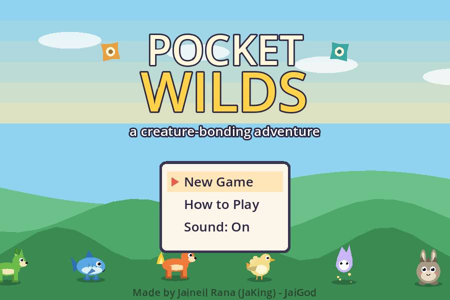
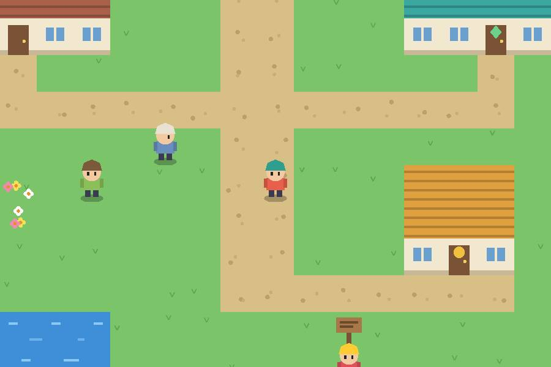
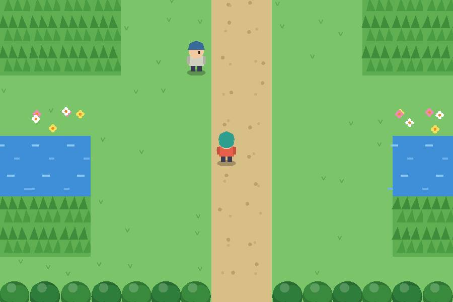
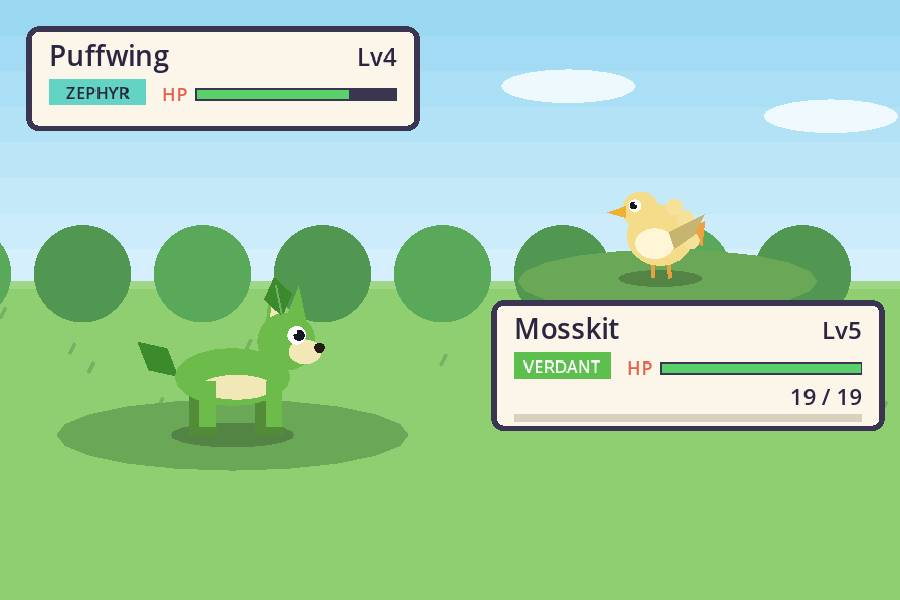
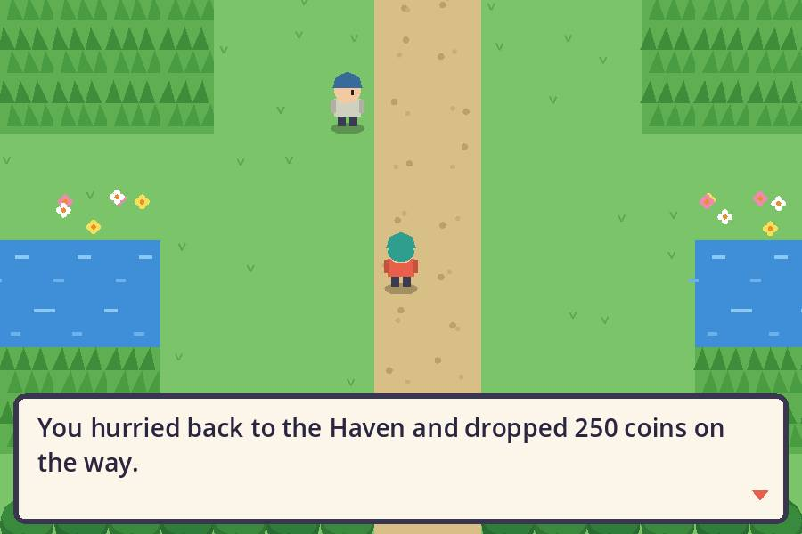
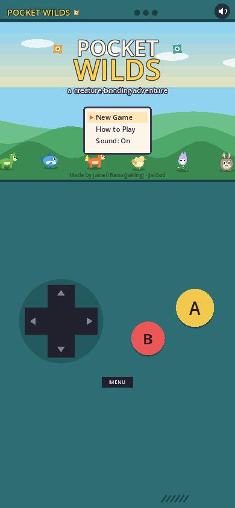

<div align="center">

# 🌿 Pocket Wilds

### An original creature-bonding RPG, built in Godot 4

**Bond with 24 original creatures · Master 6 elements · Earn 3 Warden sigils · Claim Crown Spire**

[](https://jaigod.github.io/pocket-wilds/play/)

[](https://jaigod.github.io/pocket-wilds/)
[](https://godotengine.org)
[](https://github.com/JaiGod/pocket-wilds/actions/workflows/pages.yml)
[](LICENSE)
[](https://github.com/JaiGod)



</div>

---

## 🎮 About

**Pocket Wilds** is a top-down adventure RPG where you explore a hand-built region, meet wild creatures in tall grass, and bond with them using woven charms. Every creature, tile, character, menu and note of music is **drawn or synthesized in code**: there are no sprite sheets, no audio files and no borrowed designs. The creatures, names, elements and story are all original.

Start in **Mossgate** with one of three partners, push through **Fernway Path** and **Bramble Trail**, survive the winding **Hollowdeep Cave**, rest in **Brightwater**, then climb **Skyreach Road** to the top of **Crown Spire** to face the Champion.

## 📸 Screenshots

| Mossgate town | Fernway Path |
|:---:|:---:|
|  |  |
| **Wild battle** | **The Codex** |
|  |  |

<p align="center"><b>Phone (390 px wide) with on-screen D-pad and A/B buttons</b><br></p>

## ✨ Features

- 🐾 **24 original creatures** in **12 evolution lines**, each built from code-drawn body plans (quad, fish, bird, blob, moth, golem, deer, wisp) with unique colors and features.
- 🔥 **6 elements**: Verdant, Tide, Terra, Cinder, Zephyr and Lumen. Each beats two others, so mixed teams matter.
- 🪢 **Bonding system**: weaken a wild creature, then toss a **Bonding**, **Kinship** or **Soulbond Charm**. Lower HP means better odds, and the charm wobbles before it sticks.
- 🗺️ **A full region**: 2 towns, 4 routes, the twisting Hollowdeep Cave, and Crown Spire, all tied together by sigil-gated progress.
- 🏆 **3 Wardens and a Champion**: Bryn (Grove), Korr (Deep), Sela (Sky) and Champion Aurex with a team of five.
- 👥 **Party of 6 plus Storage**: overflow partners go to Storage, and you can swap them at any Haven.
- 📖 **Codex** of seen and bonded creatures with descriptions and silhouettes.
- 📈 Levels, XP sharing, move learning and **evolution** with a glowing transformation scene.
- 🛒 Shops, healing Havens, trainers who spot you, rewards and a blackout respawn.
- 💾 **Saves** to browser storage (wrapped safely, so private windows still play).
- 🎵 Procedural chiptune music per area plus sound effects, with a sound toggle.
- 📱 **Phone ready**: on-screen D-pad, A/B/MENU buttons, tap-to-walk, and a portrait layout.
- ✨ Juice: screen shake, particles, battle wipes, HP bar easing and typewriter dialog.

## 🕹️ Controls

| Action | Keyboard | Phone |
|---|---|---|
| Move | Arrow keys / WASD | D-pad, or tap the map |
| A: talk, confirm | Z / Space / Enter | **A** button |
| B: cancel, hold to jog | X / Backspace / Shift | **B** button |
| Menu (Team, Bag, Codex, Save, Sound) | Esc / P | **MENU** button |
| Toggle sound | M | 🔊 button |

**How to bond:** walk through tall grass ➜ battle a wild creature ➜ get its HP low ➜ open **Bag** in battle ➜ throw a charm.

## 🧰 Tech stack

| | |
|---|---|
| Engine | **Godot 4.3**, GDScript, **Compatibility renderer** (WebGL 2) |
| Art | 100% procedural `_draw()` code: creatures, tiles, people, UI |
| Audio | Synthesized at runtime with `AudioStreamGenerator` |
| Web build | Godot Web export, **threads off** (no special server headers needed) |
| CI/CD | GitHub Actions with `barichello/godot-ci:4.3`: headless smoke test ➜ Web export ➜ GitHub Pages |

## 📁 Project structure

```
pocket-wilds/
├── project.godot            # Godot 4.3 project (Compatibility renderer, 480x320 pixel canvas)
├── export_presets.cfg       # Web export preset (threads off)
├── scenes/Main.tscn         # Root scene
├── scripts/
│   ├── Data.gd              # Creatures, moves, items, element chart, maps, trainers (autoload D)
│   ├── Game.gd              # Party, storage, bag, codex, stats, save/load (autoload G)
│   ├── Sfx.gd               # Procedural music and sound effects (autoload)
│   ├── Main.gd              # Input, touch pad, dialog/menu system, story flow
│   ├── Overworld.gd         # Tile map rendering, movement, NPCs, encounters
│   ├── Battle.gd            # Turn-based battles, bonding, XP, move learning
│   ├── Menus.gd             # Pause, team, bag, codex, shop, Haven, storage
│   └── Art.gd               # Code-drawn creatures, people and tiles
├── tests/Smoke.gd           # Headless test: data, battles, bonding, evolution, save/load
├── tests/capture.js         # Playwright bot that plays the live site and saves screenshots
├── web/index.html           # Landing page (deployed to /)
├── docs/screenshots/        # README and landing page images
└── .github/workflows/      # pages.yml (test, export, deploy) + screenshots.yml
```

Browse the source: [`scripts/`](scripts) · [`scenes/`](scenes) · [`tests/`](tests) · [`web/`](web) · [workflow](.github/workflows/pages.yml)

## 🛠️ Run locally

1. Install [Godot 4.3](https://godotengine.org/download/archive/4.3-stable/).
2. Clone the repo:
   ```bash
   git clone https://github.com/JaiGod/pocket-wilds.git
   cd pocket-wilds
   ```
3. Open `project.godot` in Godot and press **F5**.

Run the headless smoke test:
```bash
godot --headless --path . --import
godot --headless --path . res://tests/Smoke.tscn   # prints SMOKE OK
```

Export for the web (needs the 4.3 export templates):
```bash
godot --headless --path . --export-release "Web" build/web/index.html
cd build/web && python3 -m http.server 8000   # open http://localhost:8000
```

## 📓 Development log

- **Original from the ground up.** The goal was the feel of a classic handheld creature RPG without copying anything. Every creature is an original concept, assembled from a small set of body plans plus feature flags (leaves, flames, crests, crystals, halos), so 24 designs fit in a few hundred lines of drawing code.
- **Six elements in a ring.** Each element beats exactly two others and is resisted by two, so no single starter dominates. The smoke test checks key matchups so balance changes don't break the chart.
- **Bonding instead of capturing.** Charms use a rate formula based on missing HP, the creature's bond rate and the charm strength. Final evolutions are harder to bond, which keeps Soulbond Charms valuable late in the game.
- **One async UI system.** Dialog, menus and confirms are all `await`-able, so story scripts read top to bottom (`await say(...)`, `var i = await menu(...)`). That made the Warden and Champion scenes easy to write and to test headlessly with an auto-pilot.
- **Sigil-gated world.** Bramble Trail's cave mouth, Hollowdeep's stone door and the Spire Guard check sigils, which gives a clear order without invisible walls.
- **Phones.** The game runs on a fixed 480x320 canvas. In portrait it moves to the top of the screen and a handheld-style D-pad with A/B buttons fills the space below; on landscape touch screens the pad overlays the corners.
- **Challenge: the web build.** Godot's threaded web export needs COOP/COEP headers that GitHub Pages can't send, so the project exports with **threads off** and the **Compatibility renderer**. CI runs the smoke test before every deploy.
- **Challenge: testing in a browser.** To let an automated browser play the game, the web build exposes `window.pwState` (mode, map, party size) and a small `window.pwCmd("wild")` hook. Playwright uses them to walk from the title screen to a battle and back with zero console errors.
- **Fix:** an earlier capture script pressed keys on fixed timers and drifted out of sync with the typewriter dialog. Waiting on `pwState` instead made the run reliable.
- **Screenshots are real gameplay.** The `screenshots.yml` workflow opens the live site in headless Chromium, plays from the title screen into a battle and the Codex with [`tests/capture.js`](tests/capture.js), and commits the images to `docs/screenshots/`.
- **Beta tested on the live site ✅ (2026-11-05):** the live build at jaigod.github.io/pocket-wilds/play/ boots past the loading bar to the title screen (Godot 4.3, WebGL 2, Compatibility renderer) with no script errors. A manual session in a browser tab started a New Game, picked a partner from the three starters, went through Keeper Oda's intro and opened the pause menu in Mossgate. The `screenshots.yml` bot then played the same live site in headless Chromium, walking to Fernway Path, fighting a wild battle and opening the Codex with zero console errors. The README images come from that run.

## 🔗 More from JaiGod

- 🏠 [JaiGod on GitHub](https://github.com/JaiGod): every game, all playable in the browser
- 🌑 [The Hollow Between](https://github.com/JaiGod/the-hollow-between): a story RPG built in Godot 4
- 📜 [Runebound Saga](https://github.com/JaiGod/runebound-saga)
- 🌙 [Moonfarm](https://github.com/JaiGod/moonfarm)
- 🔥 [Isle of Embers](https://github.com/JaiGod/isle-of-embers)

## 📄 License

[MIT](LICENSE) © 2026 Jaineil Rana

---

<p align="center">Made by Jaineil Rana (JaKing) · part of <a href="https://github.com/JaiGod">JaiGod</a></p>
<div align="center">

# 🌿 Pocket Wilds

### An original creature-bonding RPG, built in Godot 4

**Bond with 24 original creatures · Master 6 elements · Earn 3 Warden sigils · Claim Crown Spire**

[](https://jaigod.github.io/pocket-wilds/play/)

[](https://jaigod.github.io/pocket-wilds/)
[](https://godotengine.org)
[](https://github.com/JaiGod/pocket-wilds/actions/workflows/pages.yml)
[](LICENSE)
[](https://github.com/JaiGod)


</div>

---

## 🎮 About

**Pocket Wilds** is a top-down adventure RPG where you explore a hand-built region, meet wild creatures in tall grass, and bond with them using woven charms. Every creature, tile, character, menu and note of music is **drawn or synthesized in code**: there are no sprite sheets, no audio files and no borrowed designs. The creatures, names, elements and story are all original.

Start in **Mossgate** with one of three partners, push through **Fernway Path** and **Bramble Trail**, survive the winding **Hollowdeep Cave**, rest in **Brightwater**, then climb **Skyreach Road** to the top of **Crown Spire** to face the Champion.

## 📸 Screenshots

| Mossgate town | Fernway Path |
|:---:|:---:|
|  |  |
| **Wild battle** | **The Codex** |
|  |  |

<p align="center"><b>Phone (390 px wide) with on-screen D-pad and A/B buttons</b><br></p>

## ✨ Features

- 🐾 **24 original creatures** in **12 evolution lines**, each built from code-drawn body plans (quad, fish, bird, blob, moth, golem, deer, wisp) with unique colors and features.
- 🔥 **6 elements**: Verdant, Tide, Terra, Cinder, Zephyr and Lumen. Each beats two others, so mixed teams matter.
- 🪢 **Bonding system**: weaken a wild creature, then toss a **Bonding**, **Kinship** or **Soulbond Charm**. Lower HP means better odds, and the charm wobbles before it sticks.
- 🗺️ **A full region**: 2 towns, 4 routes, the twisting Hollowdeep Cave, and Crown Spire, all tied together by sigil-gated progress.
- 🏆 **3 Wardens and a Champion**: Bryn (Grove), Korr (Deep), Sela (Sky) and Champion Aurex with a team of five.
- 👥 **Party of 6 plus Storage**: overflow partners go to Storage, and you can swap them at any Haven.
- 📖 **Codex** of seen and bonded creatures with descriptions and silhouettes.
- 📈 Levels, XP sharing, move learning and **evolution** with a glowing transformation scene.
- 🛒 Shops, healing Havens, trainers who spot you, rewards and a blackout respawn.
- 💾 **Saves** to browser storage (wrapped safely, so private windows still play).
- 🎵 Procedural chiptune music per area plus sound effects, with a sound toggle.
- 📱 **Phone ready**: on-screen D-pad, A/B/MENU buttons, tap-to-walk, and a portrait layout.
- ✨ Juice: screen shake, particles, battle wipes, HP bar easing and typewriter dialog.

## 🕹️ Controls

| Action | Keyboard | Phone |
|---|---|---|
| Move | Arrow keys / WASD | D-pad, or tap the map |
| A: talk, confirm | Z / Space / Enter | **A** button |
| B: cancel, hold to jog | X / Backspace / Shift | **B** button |
| Menu (Team, Bag, Codex, Save, Sound) | Esc / P | **MENU** button |
| Toggle sound | M | 🔊 button |

**How to bond:** walk through tall grass ➜ battle a wild creature ➜ get its HP low ➜ open **Bag** in battle ➜ throw a charm.

## 🧰 Tech stack

| | |
|---|---|
| Engine | **Godot 4.3**, GDScript, **Compatibility renderer** (WebGL 2) |
| Art | 100% procedural `_draw()` code: creatures, tiles, people, UI |
| Audio | Synthesized at runtime with `AudioStreamGenerator` |
| Web build | Godot Web export, **threads off** (no special server headers needed) |
| CI/CD | GitHub Actions with `barichello/godot-ci:4.3`: headless smoke test ➜ Web export ➜ GitHub Pages |

## 📁 Project structure

```
pocket-wilds/
├── project.godot            # Godot 4.3 project (Compatibility renderer, 480x320 pixel canvas)
├── export_presets.cfg       # Web export preset (threads off)
├── scenes/Main.tscn         # Root scene
├── scripts/
│   ├── Data.gd              # Creatures, moves, items, element chart, maps, trainers (autoload D)
│   ├── Game.gd              # Party, storage, bag, codex, stats, save/load (autoload G)
│   ├── Sfx.gd               # Procedural music and sound effects (autoload)
│   ├── Main.gd              # Input, touch pad, dialog/menu system, story flow
│   ├── Overworld.gd         # Tile map rendering, movement, NPCs, encounters
│   ├── Battle.gd            # Turn-based battles, bonding, XP, move learning
│   ├── Menus.gd             # Pause, team, bag, codex, shop, Haven, storage
│   └── Art.gd               # Code-drawn creatures, people and tiles
├── tests/Smoke.gd           # Headless test: data, battles, bonding, evolution, save/load
├── tests/capture.js         # Playwright bot that plays the live site and saves screenshots
├── web/index.html           # Landing page (deployed to /)
├── docs/screenshots/        # README and landing page images
└── .github/workflows/      # pages.yml (test, export, deploy) + screenshots.yml
```

Browse the source: [`scripts/`](scripts) · [`scenes/`](scenes) · [`tests/`](tests) · [`web/`](web) · [workflow](.github/workflows/pages.yml)

## 🛠️ Run locally

1. Install [Godot 4.3](https://godotengine.org/download/archive/4.3-stable/).
2. Clone the repo:
   ```bash
   git clone https://github.com/JaiGod/pocket-wilds.git
   cd pocket-wilds
   ```
3. Open `project.godot` in Godot and press **F5**.

Run the headless smoke test:
```bash
godot --headless --path . --import
godot --headless --path . res://tests/Smoke.tscn   # prints SMOKE OK
```

Export for the web (needs the 4.3 export templates):
```bash
godot --headless --path . --export-release "Web" build/web/index.html
cd build/web && python3 -m http.server 8000   # open http://localhost:8000
```

## 📓 Development log

- **Original from the ground up.** The goal was the feel of a classic handheld creature RPG without copying anything. Every creature is an original concept, assembled from a small set of body plans plus feature flags (leaves, flames, crests, crystals, halos), so 24 designs fit in a few hundred lines of drawing code.
- **Six elements in a ring.** Each element beats exactly two others and is resisted by two, so no single starter dominates. The smoke test checks key matchups so balance changes don't break the chart.
- **Bonding instead of capturing.** Charms use a rate formula based on missing HP, the creature's bond rate and the charm strength. Final evolutions are harder to bond, which keeps Soulbond Charms valuable late in the game.
- **One async UI system.** Dialog, menus and confirms are all `await`-able, so story scripts read top to bottom (`await say(...)`, `var i = await menu(...)`). That made the Warden and Champion scenes easy to write and to test headlessly with an auto-pilot.
- **Sigil-gated world.** Bramble Trail's cave mouth, Hollowdeep's stone door and the Spire Guard check sigils, which gives a clear order without invisible walls.
- **Phones.** The game runs on a fixed 480x320 canvas. In portrait it moves to the top of the screen and a handheld-style D-pad with A/B buttons fills the space below; on landscape touch screens the pad overlays the corners.
- **Challenge: the web build.** Godot's threaded web export needs COOP/COEP headers that GitHub Pages can't send, so the project exports with **threads off** and the **Compatibility renderer**. CI runs the smoke test before every deploy.
- **Challenge: testing in a browser.** To let an automated browser play the game, the web build exposes `window.pwState` (mode, map, party size) and a small `window.pwCmd("wild")` hook. Playwright uses them to walk from the title screen to a battle and back with zero console errors.
- **Fix:** an earlier capture script pressed keys on fixed timers and drifted out of sync with the typewriter dialog. Waiting on `pwState` instead made the run reliable.
- **Screenshots are real gameplay.** The `screenshots.yml` workflow opens the live site in headless Chromium, plays from the title screen into a battle and the Codex with [`tests/capture.js`](tests/capture.js), and commits the images to `docs/screenshots/`.
- **Beta tested on the live site ✅ (2026-11-05):** BETA_PENDING

## 🔗 More from JaiGod

- 🏠 [JaiGod on GitHub](https://github.com/JaiGod): every game, all playable in the browser
- 🌑 [The Hollow Between](https://github.com/JaiGod/the-hollow-between): a story RPG built in Godot 4
- 📜 [Runebound Saga](https://github.com/JaiGod/runebound-saga)
- 🌙 [Moonfarm](https://github.com/JaiGod/moonfarm)
- 🔥 [Isle of Embers](https://github.com/JaiGod/isle-of-embers)

## 📄 License

[MIT](LICENSE) © 2026 Jaineil Rana

---

<p align="center">Made by Jaineil Rana (JaKing) · part of <a href="https://github.com/JaiGod">JaiGod</a></p>
